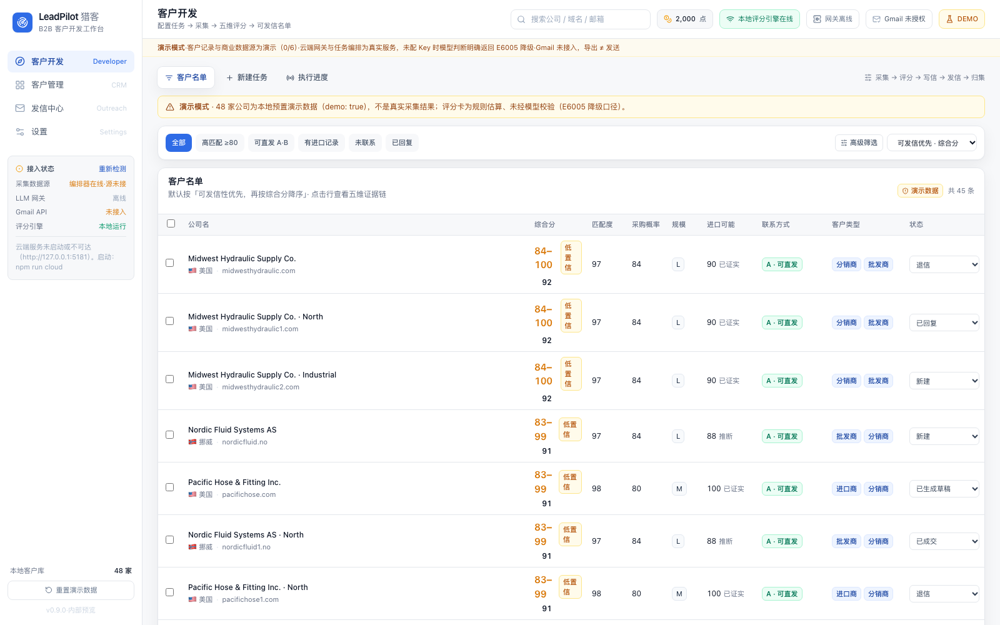
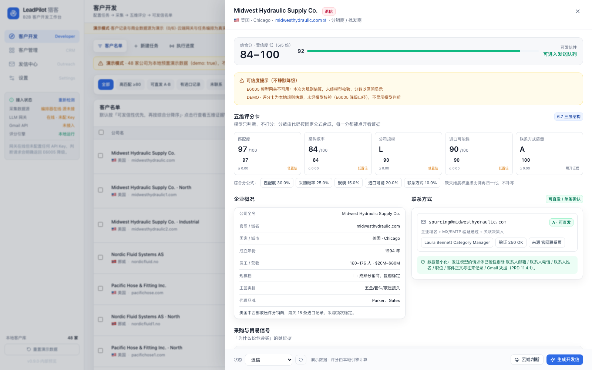
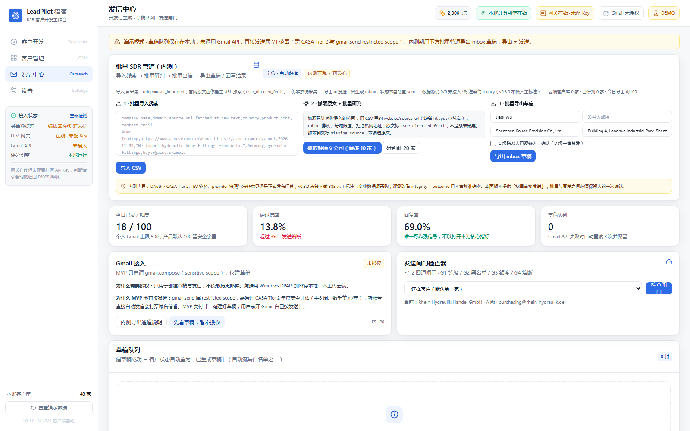
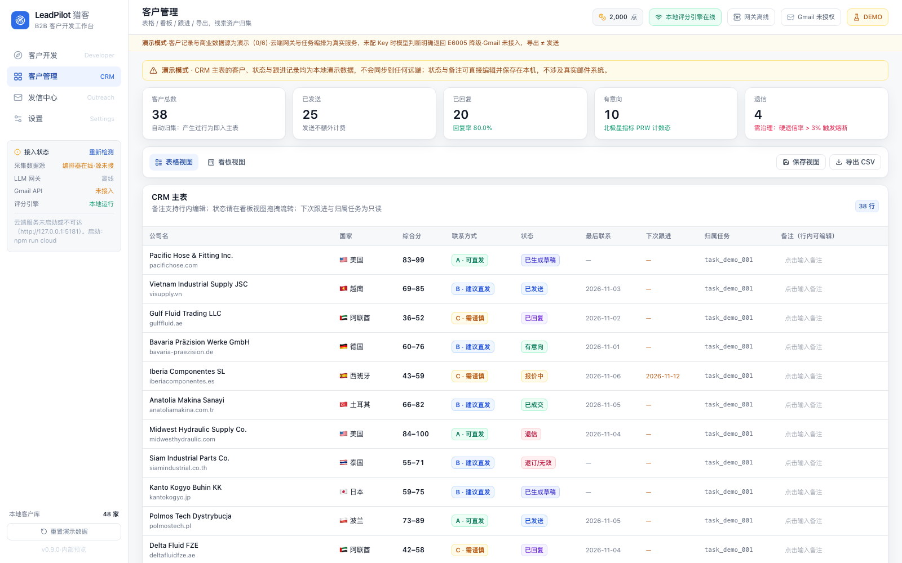
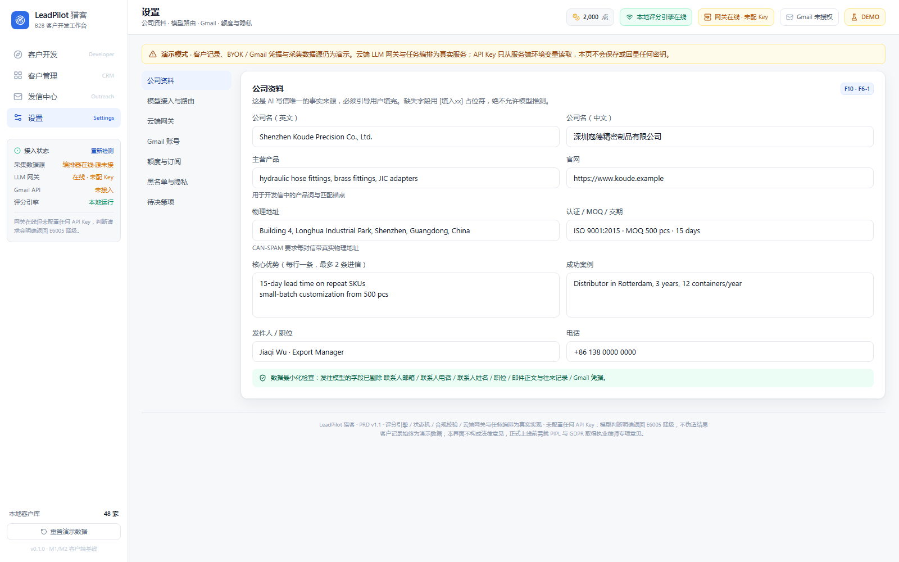
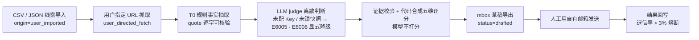

# LeadPilot 猎客

**B2B 外贸客户开发工作台 · 面向批量 SDR 的自动获客管道**

[](https://github.com/Gakiwoo/LeadPilot/actions/workflows/ci.yml)

`v0.9.0` · `positioning: auto_prospecting` · `stage: internal_preview` · `releaseEligible: false` · Node 22

> 需求真源：WorkBuddy 资料库《PRD-LeadPilot-B2B 外贸客户开发工作台 v1.1》。
> 本仓库是**可运行、可单测、可审计的工程基线**，不是已上线产品。

一句话：把 PRD 里「评分可信度」这条产品假设写成了真实代码，并让批量 SDR 用自己手上的线索清单跑完
**导入 → 补齐原文 → 批量研判 → 批量出信 → 结果回写** 的完整管道。
它不做凭空发现公司的商业采集，也不替你按发送键；这两件事在文档和代码里都被明确标注。

---

## 界面预览

> 以下 5 张全部是本机 **v0.9.0 + B3 定稿代码实际运行渲染**（Chrome headless / CDP，1600×1000 @1x），不是设计稿、不是合成图；UI 文案或可访问性改动后会重新捕获。
> 列表里的 48 家公司是演示数据（`demo: true`），页面常驻 DEMO 提示条（全站常驻 + 页内专项）；截图时网关未配 API Key，
> 处于 `E6005` 显式降级态 —— 这是如实状态，不是坏图。原始文件见 [`docs/screenshots/`](docs/screenshots/)。



<table>
  <tr>
    <td width="50%" valign="top">
      <br>
      <b>客户详情</b> · 五维评分卡、企业概况、采购与贸易信号、云端判断 / 开发信入口
    </td>
    <td width="50%" valign="top">
      <br>
      <b>发信中心</b> · 批量 SDR 管道（内测）三步、定位徽标、发送闸门检查器与草稿队列
    </td>
  </tr>
  <tr>
    <td width="50%" valign="top">
      <br>
      <b>客户管理</b> · 状态看板、CRM 主表（状态 / 备注 / 跟进日期可编辑）、CSV 导出
    </td>
    <td width="50%" valign="top">
      <br>
      <b>设置</b> · 公司资料、模型与网关、Gmail、合规与隐私；左侧如实显示「未接入」状态
    </td>
  </tr>
</table>

---

## 产品定位与决策

| 项 | 结论 |
|---|---|
| 定位 | **自动获客**（不是「研判提效」） |
| 目标用户 | **批量 SDR** |
| 自动化对象 | 批量补全 → 批量研判 → 批量出信 → 批量触达与回写 |
| 线索来源 | 用户投喂（CSV / JSON）+ 用户指定 URL 抓取，**`origin=user_imported`** |
| 当前阶段 | `internal_preview`（内测预览） |
| 评测口径 | `integrity + outcome`（零人工标注）；`accuracyClaim` 恒 `false` |
| 正式发布 | `releaseEligible` 恒 `false`；Go / No-Go 第 1 条（数据源合同）与第 3 条（385 标注启动）已由 v0.8.0 决策取消，第 2 / 4 / 5 条继续有效；`npm run gate` 实跑 5 条 `BLOCKED` |

三次用户拍板，均写进代码与门禁：

- **v0.7.0**：定位不变。CSV 导入是批量 SDR 既有的线索投喂通道（展会名录 / 海关导出 / CRM 存量），不是形态降级；四项外部依赖从「阻塞研发」重分类为**发布门禁**。
- **v0.8.0**：**不做 385 家人工标注基准集、不做商业数据源采购**。评测改看 integrity + outcome；标注契约降级 legacy；商业 6 类源继续如实 `0/6`；`internalPreviewReady` / `externalValidated` / `releaseEligible` 三态分离；没有人工真值就**永久不宣称准确率**。
- **v0.9.0**（ADR-032）：落地「用户指定 URL 抓取」作为原文投喂通道 —— robots.txt 遵从、每域 ≤1 req/s、8s 超时、≤512KB、正文 ≤2 万字符、只收 HTML / 纯文本、拒绝回环 / 私网 / link-local（含 DNS 解析到私网）。来源标 `user_directed_fetch`；**抓取 ≠ 采集**，商业源仍 `0/6`，抓取单独计数；失败逐条 `missing_source`，不编造原文。

---

## 快速开始

Node 22，服务端零额外依赖，需要两个进程：

```bash
npm ci

# 终端 A · 云端网关 + 任务编排器（127.0.0.1:5181）
npm run cloud

# 终端 B · 前端（127.0.0.1:5180，dev / preview 仅绑定回环）
npm run dev
```

打开 <http://127.0.0.1:5180/>。全量验证：

```bash
npm run typecheck       # TS strict + noUncheckedIndexedAccess（索引访问必须显式判空）
npm test                # 199 个用例 / 10 文件 / 0 skipped（前端 46 + 服务端 153）
npm run gate            # 发布门禁 60 项自检，输出 releaseBlocked=true
npm run check:tracked   # 干净检出全量校验：src/server/shared/scripts 与 git ls-files 对账
npm run build           # 类型检查 + 生产构建
npm run smoke           # 48 项云端端到端冒烟（默认端口 5181，需先启动 npm run cloud）
npm run verify:restart  # AC-03 真实杀进程 → 同库重启 → 断点续跑（独立端口 5193）
npm run validate:baseline -- --self-test   # legacy 标注导入校验器反例自检
```

`VITE_LEADPILOT_API` 覆盖前端网关地址，`LEADPILOT_PORT` / `LEADPILOT_HOST` 控制服务端监听。
完整环境变量样板见 [`.env.example`](.env.example)（**不含任何真实 Key**）。

---

## 管道怎么跑



四条管道红线，全部由服务端与门禁脚本强制：

1. **导入 ≠ 采集**：每行标 `origin=user_imported`，出现 `system_collected` / `auto_collected` / `scraped` / `crawled` 一律拒行；域名规范化后批内 / 库内去重，逐行返回 `accepted / rejected / duplicates`，单行失败不影响整批。
2. **抓取 ≠ 采集**：`/v1/sources/fetch` 只抓调用方显式给出的 URL，不发现、不爬全站、不猜地址；原文经 PII 清洗后进入 T0 → judge。
3. **导出 ≠ 发送**：`/v1/export/eml` 只生成 mbox 草稿，`exportedIsNotSent=true`、状态停在 `drafted`，不调用任何邮件 API；D 级禁发、C 级逐条确认、真实身份与退订尾巴由调用方本地注入，服务端只校验存在性。
4. **降级 ≠ 成功**：批量研判按 `succeeded / degraded / failed` 分桶，`E6005` / `E6008` 不写回 `judgement`；退信样本为 0 时 `rate=null`，不伪造 0%。

---

## 能力矩阵

| 层 | 状态 | 说明 |
|---|---|---|
| 五维评分引擎（PRD 6.7） | ✅ 真实实现 | 规则确定性计算 → 模型离散枚举 → 证据逐字校验 → 代码合成；权重再归一化、α 上限、冲突保守、疑似同行折叠 |
| 12 态状态机 / 合规红线（F6–F8） | ✅ 真实实现 | 自动流转白名单、不可逆终态、批量二次确认、全量留痕、Ctrl+Z 撤销；禁词 / 字数 / 退订尾巴 / 四道发送闸门、批量直接发送硬禁用 |
| 云端 LLM 网关（F0） | ✅ 服务端真实实现 | 三级路由、超时 / 429 / 5xx 降级链、schema + 证据校验、30 天缓存、熔断、PII 硬剔除、**模型快照锁定**、调用审计 |
| 云端任务编排（F2 / 9.1） | ✅ 服务端真实实现 | 6 阶段状态机、SSE 单向推流、游标、暂停 / 继续 / 中止、硬超时、并发上限 3 的 FIFO 闸门、**跨进程恢复（AC-03）** |
| 点数账本（F0-6 / v0.6.0） | ✅ 真实实现 | `reserve / settle / release / charge / grant` 事务化 + `idem_key` 幂等；任务与网关真实调用共用一本账，失败 / 降级 / 缓存命中全额释放 |
| T0 规则抽取 + T0 → judge 事实链 | ✅ 真实实现 | 确定性词表、不调模型不联网；冲突由 `reconcileWithT0()` 代码保守裁决，`no_signal` 不补零 |
| 服务端安全 / 持久化 | ✅ 真实实现 | 非回环强制 Bearer（401 `E6009`）、CORS 白名单、限流（429 `E6010`）、不安全启动组合拒绝；`sqlite / json / memory` 存任务 / 缓存 / 审计 / 账本 / companies / outcomes |
| 评测口径 integrity + outcome（v0.8.0） | ✅ 纯函数真实实现 | 可溯源 / 规则遵从 / schema / 证据逐字核验 + 真实硬退信率；无真实样本一律 `NO_DATA`；`diffEvalRuns()` 版本 diff 不伪造 delta |
| 用户指定 URL 抓取（v0.9.0） | ✅ 真实实现 | robots 遵从、每域限速、重定向上限 3 且逐跳重做 SSRF 校验、内容哈希、PII 清洗 |
| **批量 SDR 管道（v0.7.0）** | 🟡 **内测可用** | CSV / JSON 导入 → T0 + 真实 `judge()` 批量研判 → mbox 草稿导出 → 结果回写与 3% 退信熔断；`companies` / `outcomes` 落库 |
| 真实 provider 调用 | 🟡 配置即用 | Key 从服务端环境变量读取，**且必须锁定 `LEADPILOT_MODEL_VERSION_*` 具体快照**；仓库不内置 Key、不预置猜测版本号 |
| 数据源注册表（9.3） | ⚪ 契约真实 / 实现 `0/6` | 逐源健康如实上报；即使注入实现也返回 `blocked` 并暂停任务（ADR-017「可插拔 ≠ 可放行」） |
| 385 家人工标注集 | ❌ 决策不做 | 契约与校验器保留为 legacy（`status=legacy` / `enabled=false`），不参与当前判定；仓库不提供、不生成任何标注样本 |
| 商业数据源采购 / Gmail OAuth + CASA / Tauri 2 + DPAPI + EV 签名 | ❌ 未接入 | 接口已抽象，属正式发布门禁项，见 [`docs/ARCHITECTURE.md`](docs/ARCHITECTURE.md) |

---

## 先读这句：诚实边界

> **演示数据不是真实采集结果，批量导入不是采集，用户指定抓取不是系统采集，mbox 导出更不是发送，`E6005` 降级不是成功，未锁快照不是可调用，`0/6` 数据源不是「已接入」，审计里的 `points` 不是已扣点，导入校验通过不等于评测通过，integrity 通过不等于判得准，内测可跑不等于可正式发布。**
>
> 未配 API Key → `503 E6005`；只配 Key 但没锁 `model_version` → `E6008`；两者齐备才发起真实 provider 调用。
> 六类数据源、Gmail OAuth 与 Tauri 外壳均未接入；客户记录带 `demo: true`，界面常驻 DEMO 黄条。
> 响应里的 `points` 只是 token 折算估值，**只有 `billing.charged=true` 才代表实际扣点**。
> v0.8.0 决策不做人工标注集，因此没有准确率可宣称：`accuracyClaim` 恒 `false`，任何以人工真值为前提的数字断言都会被 `npm run gate` 静态扫描拦下。
> 任何降级路径都**不返回一段看起来像模型写的假正文**；分数改为区间显示并标注「未经模型校验」。这是对 PRD 6.7「不能假知道」的工程落实。

---

## 发布状态：三态分离

| 状态 | 由什么决定 | 当前 |
|---|---|---|
| `internalPreviewReady` | integrity 门禁：可溯源 / 规则遵从 / schema / 证据逐字核验（`minSamples=100`） | 无真实原文样本 → `NO_DATA` |
| `externalValidated` | outcome 门禁：真实发送硬退信率 ≤3%（`minSamples=30`）+ 跨运行一致性 | 无真实发送事件 → `NO_DATA` |
| `releaseEligible` | 前两项 + 外部条件 | **恒 `false`** |

`npm run gate` 当前打印的阻断项（`releaseBlocked = true`）：

- integrity 门禁 `NO_DATA`、业务结果门禁 `NO_DATA`（无真实样本，不得宣称准确率 / 回复率）；
- 用户指定抓取器已就绪（robots / 限速 / SSRF），但尚无真实站点样本进入 integrity；
- provider 模型快照需运行时注入 `LEADPILOT_MODEL_VERSION_*`（未锁即 `E6008`）；
- Google OAuth / CASA Tier 2 / EV 代码签名 / PIPL·GDPR 法律意见：未开始。

> **自检全绿只证明边界没被伪造，不证明产品可发布。** 门禁断言失败会让 CI 变红；外部条件未满足则明确打印阻断项、退出码 0。

---

## 云端 API

`/health` 为探活保留无鉴权；其余 `/v1/*` 在启用 token 或对外监听时一律要求 `Authorization: Bearer <token>`。
因为 `EventSource` 不能带 Authorization，前端改用 `fetch` 流式读取 SSE 帧，**绝不把 token 拼进 query**。

核心端点：

| 方法 | 路径 | 说明 |
|---|---|---|
| GET | `/health` | 版本 / 网关 / 安全 / 持久化 / 账本 / `t0.judgeFactChain` / 数据源 / `batch` |
| GET | `/v1/points` | 账本只读：余额 / 冻结 / 已结算 / 流水（无充值写接口） |
| POST | `/v1/t0/extract` | T0 规则事实抽取；非法来源或 PII → 400 `E6004` |
| POST | `/v1/judge` | 五维判断；可传 `sources` 启用 T0 事实链、`requestId` 启用计费幂等；成功带 `billing` |
| POST | `/v1/email/generate` | T1 写信；降级时正文为 `null`，不生成假正文 |
| GET / POST | `/v1/tasks` | 创建 / 列出任务；预扣不足 `402 E4001` 且不创建任务；快照含 `queuePosition` / `maxConcurrent` |
| GET | `/v1/tasks/:id/events` | SSE：`hello / queued / started / stage / progress / source_warning / paused / resumed / done / aborted` |
| POST | `/v1/import/companies` | 批量导入；伪称 `system_collected` 的行直接拒绝；无可接受行 → `E4007` |
| POST | `/v1/batch/judge` | 批量研判（`batchSize` ≤ 50）；降级计入 `degraded`，不写回 `judgement` |
| POST | `/v1/export/eml` | mbox 草稿导出；合规闸门拒绝 `E4009`、熔断中 `423 E4010` |
| POST | `/v1/import/outcomes` | 结果回写；`unsubscribed / invalid` 需逐条确认且不可逆 |
| POST | `/v1/sources/fetch` | 用户指定 URL 临时抓取（单次 ≤10，不写库、不发现 URL） |
| POST | `/v1/batch/fetch-sources` | 为已导入且缺原文的公司抓官网（≤50），写回 `rawText / sourceUrl / fetchedAt` |
| POST | `/v1/eval/integrity` · `/v1/eval/outcome` · `/v1/eval/diff` | 零人工评测与版本 diff；无样本 `NO_DATA` / 无基线 `NO_BASELINE` |

<details>
<summary>完整端点清单（legacy / 评测 / 数据源 / 网关诊断）</summary>

| 方法 | 路径 | 说明 |
|---|---|---|
| GET | `/v1/gateway/health` | provider 清单（`pinned` / `modelVersion`）、熔断、缓存、审计、账本、基准契约、T0 事实链、数据源 |
| GET | `/v1/gateway/audit` | 调用审计（只记元数据）+ 熔断状态 + 缓存统计 |
| GET | `/v1/sources/health` | 用户指定抓取器健康：`user-directed-fetch-v1`、robots / 限速 / SSRF 策略；**单独计数，不并入商业源 0/6** |
| GET | `/v1/batch/health` | 批量管道状态：定位 / 阶段 / 客户数 / 已研判 / 今日导出 / 退信率 / 熔断 |
| GET | `/v1/eval/baseline/contract` | legacy 标注导入契约（只返回口径，不返回样本） |
| POST | `/v1/eval/baseline/validate` | 校验 legacy 导入数据；不合规 → 400 `E4004` |
| GET | `/v1/eval/gates` | 门禁清单：legacy 契约 + `integrityGate` / `outcomeGate` / `release` |
| POST | `/v1/eval/run` | 跑 legacy 基准集；无样本 `NO_DATA` |
| GET | `/v1/eval/integrity/gates` | `integrity-gate-v1`：零标注、`minSamples=100` |
| GET | `/v1/eval/outcome/gates` | `outcome-gate-v1`：真实退信率、`minSamples=30` |
| POST | `/v1/tasks/:id/pause` · `/resume` · `/abort` | 任务控制；收尾时账本结算 / 释放并写进任务日志 |

错误文案统一「发生了什么 + 可能原因 + 你可以怎么做 + 错误码」（PRD A.2）。
错误码：`E6004` PII / 非法来源、`E6005` 无可用 provider、`E6008` 快照未锁定、`E6009` 鉴权失败、`E6010` 限流、
`E4001` 点数不足、`E4002` 账本幂等键冲突、`E4003` 账本状态非法、`E4004` 标注导入不合规、`E4005` 计费键已结算、
`E4006` 评测 diff 归档非法、`E4007`–`E4010` 批量管道 / 合规闸门、`E4011`–`E4013` 抓取 SSRF / 内容 / robots。

</details>

> **点数口径**：云端任务与网关真实调用共用一本账。有可用 provider 才预扣（T0 / T1 / T2 上限 8 / 16 / 40 点），
> 内容校验通过才按 token 折算 `ceil` 成整数点结算；失败 / 降级 / 缓存命中 / 校验拒绝一律全额释放。
> 这是本地测试账本，不是真实支付结算系统；未注入账本的独立网关仍如实标 `billing.scope='audit-only'`。

---

## 配置要点

```bash
# 仅本机开发：默认 local-open，无需 token
LEADPILOT_HOST=127.0.0.1
LEADPILOT_STORE=sqlite           # node:sqlite 不可用时自动降级为 json 文件兜底
LEADPILOT_DB_PATH=./data/leadpilot.db
LEADPILOT_POINTS_BALANCE=2000    # 开户初始点数（任务 + 网关共用）

# 对外部署：以下两项必须同时配置，否则服务拒绝启动
LEADPILOT_HOST=0.0.0.0
LEADPILOT_API_TOKEN=<强随机令牌>
LEADPILOT_CORS=https://your-frontend.example.com
VITE_LEADPILOT_TOKEN=<同上>      # 浏览器端 token 会暴露，生产应改为同源反向代理注入

# 真实模型调用 = Key + 具体快照，二者缺一不可
DEEPSEEK_API_KEY=<key>
LEADPILOT_MODEL_VERSION_DEEPSEEK_PRO=deepseek-chat-<具体快照ID>

# legacy：仅当将来真导入人工标注时设置；v0.8.0 决策不要求标注，仓库不提供也不生成
# LEADPILOT_BASELINE_FILE=./data/baseline-legacy.jsonl
```

> **模型快照纪律**：`shared/model-protocol.json` 的 `rules.requirePinnedModelVersion = true`。
> 含 `-latest` 的浮动指针一律判未锁定，`/v1/gateway/health` 显示 `pinned=false`，且不进入降级链。
> 基线不预置任何猜测版本号 —— 版本号必须由运维从 provider 官网查得后注入。

---

## 工程结构

```
shared/
├── model-protocol.json        前后端 + 评测 + T0 + 账本 + 批量管道 + 抓取策略的单一真源
└── baseline-contract.json     legacy 标注导入契约（只定义口径，不含样本）
server/
├── protocol.mjs       schema / 证据 / PII / 计费 / 缓存键 / Prompt（含 <t0_facts>）/ wire→client
├── gateway.mjs        三级路由 · 降级链 · 熔断 · 审计 · 计费 reserve/settle/release · judge() / writeEmail()
├── orchestrator.mjs   任务状态机 · SSE · 游标 · FIFO 并发闸门 / 硬超时 · 账本 · 重启恢复
├── store.mjs          sqlite / json / memory：任务 / 缓存 / 审计 / 账本 / companies / outcomes
├── ledger.mjs         点数账本事务化 + 幂等
├── batch.mjs          批量 SDR 管道：CSV 解析 / 去重 / T0+judge 批处理 / mbox / 结果回写与熔断
├── fetch.mjs          用户指定 URL 抓取：robots / 限速 / SSRF / HTML→文本 / PII 清洗 / 哈希
├── t0.mjs             T0 规则抽取 + reconcileWithT0 冲突裁决
├── data-sources.mjs   6 类数据源注册表 · health · 显式 demo/blocked
├── eval.mjs           integrity / outcome / consistency / releaseStatus + diffEvalRuns()
├── baseline.mjs       legacy 标注契约解析与导入校验器
├── index.mjs          Node 原生 http 入口：鉴权 / CORS / 限流 / 路由
└── tests/             114 个服务端测试
src/
├── domain/            纯函数领域层（无 React、无 IO）—— 改这里要写测试
├── services/          adapters.ts 唯一入口 + gateway-client / task-runner / email-generator
├── store/             Zustand 单一状态源（本地 / 云端运行器切换）
├── components/        四大页面 · 详情抽屉 · 开发信编辑器 · 批量 SDR 管道面板
└── tests/             32 个前端测试
scripts/               e2e-smoke · check-release-gates · validate-baseline · verify-restart · fixtures
docs/                  PM-REVIEW · ARCHITECTURE（ADR-001–032）· PRD-COVERAGE · screenshots
.github/workflows/ci.yml  干净检出 / typecheck / gate / 校验器自检 / test / build / smoke / AC-03
```

---

## 质量与验证

| 检查 | 结果（v0.9.0） |
|---|---|
| `npm run typecheck` / `npm run build` | 通过；`strict` + `noUncheckedIndexedAccess` 双开，门禁静态锁死；`/health.version` 与侧栏版本号均从 `package.json` 读取，不再硬编码；生产构建 353.78 kB / gzip 119.45 kB |
| `npm test` | **199 / 199 全绿，0 skipped**（10 文件；前端 46 + 服务端 153） |
| `npm run gate` | **60 / 60 自检通过**，输出 `releaseBlocked=true` 与 5 条 `BLOCKED` |
| `npm run check:tracked` | **60 个源码/配置全部纳入版本控制**，83 个 tracked 文件无缺失 |
| `npm run smoke` | **48 / 48 通过**（默认端口 5181，需先启动 `npm run cloud`） |
| `npm run verify:restart` | **AC-03 全链路 PASS**：杀进程 → 同库重启 → `paused`、游标 / 点数 / 冻结额一致、显式继续从原游标续跑、只有一条预扣流水 |
| `npm run validate:baseline -- --self-test` | 继续拒绝非法标注与空基准集（legacy 通道） |
| GitHub Actions | B3 提交 run `42989595650` **15 步全绿**，含干净检出、门禁、AC-03 重启与 48 项冒烟 |

提交链（历史节选）：`75dda08 feat(eval,fetch) …（v0.9.0）` → `980fc87 docs …` → `e37ac53 docs: 记录 CI run 与提交链` → `f9bcd69`（v0.9.0 远端）→ `4bccea9`（B1 · 3 个 P0）→ `000a8c0`（B2 · 17 个 P1）→ B3 修复批次。**当前 HEAD 一律以 `git log -1` 为准**，文档不再写死最新提交号，避免提交链随每次提交漂移。
历史专项（v0.6.0–v0.8.0，仍全绿）：网关计费 9 个单测、评测 diff 8 个单测、并发队列 FIFO 与硬超时、批量管道 8 个单测、integrity / outcome 6 个单测。
启动前置安全（已自动化，不再是一次性人工验证）：`server/tests/startup-security.test.mjs` 用真实子进程断言 `HOST=0.0.0.0` 无 token / `CORS=*` 必须 `exit(1)`；`server/tests/cloud.test.mjs` 断言启用 token 后 401 `E6009` / Bearer 200 / 非白名单 Origin 不回显 / 回环下 `CORS=*` 不回显通配。

<details>
<summary>已踩过的坑（改代码前建议看一眼）</summary>

- **干净检出才暴露的坑（已修）**：`.gitignore` 里写 `data/` 会匹配**任意层级**的 `data` 目录，把源码 `src/data/` 一并排除，首提交漏掉 `demo-data.ts` 与 `repository.ts`。本地全绿、CI 干净检出报 `TS2307`。现改为 `/data/` 锚定仓库根；B3-3 起 CI 不再维护 31 项硬编码清单，改由 `npm run check:tracked` 全量枚举 `src / server / shared / scripts` 与 `git ls-files` 对账。**结论：本地全绿不等于仓库可构建。**
- **Vite / Vitest 注意**：`server/store.mjs` 用 `process.getBuiltinModule('node:sqlite')` 同步探测，不能用 `await import('node:sqlite')` —— Vite 会把动态 import 重写成 `import('sqlite')`，导致 Vitest 下探测失败、`createStore()` 静默退到 JSON 兜底。B3-3 已消除 `it.skipIf`：sqlite 不可用时改测 JSON 兜底同样能跨实例恢复，绝不以「0 skipped」的假绿掩盖缺失能力。
- **依赖安全（ADR-018）**：`npm audit` 报 6 项（3 moderate / 1 high / 2 critical），**全部在 dev 工具链**（Vite 5.4.21 / Vitest 2.1.9 / esbuild / tinypool / vite-node / @vitest/mocker），生产 `dist/` 不含这些组件。无损 `npm audit fix` 实测零效果，全部需跨 major 到 Vite 8 / Vitest 5，**不执行 `--force`**；升级需单独分支 + 完整回归。

</details>

---

## 设计纪律（改代码前先读）

<details>
<summary>展开 23 条工程纪律</summary>

1. **模型不打分。** 受限输出协议出现 `score / total_score / rating / points` 整条作废；分数只由 `scoring.ts` 计算。
2. **证据必须可核验。** 引用无法在 `<context>` 原文中模糊匹配（命中率 < 90%）→ 字段整条丢弃并回退规则分；可溯源率 < 95% 阻断发布。T0 抽取更严格：`quote` 必须是原文连续子串。
3. **冲突不平均。** `|rule − model| > 30` 保守取规则值；T0 规则事实与模型判断冲突同样由代码保守裁决、置信度归零并标待复议。
4. **缺失不补零。** 维度无数据 → 权重再归一化，UI 标注「基于 4/5 维」；`no_signal` 不等于「确认没进口」。
5. **合规写进代码。** 真实身份 / 物理地址 / 退订尾巴由客户端注入，模型与服务端都不接触；批量直接发送硬禁用。
6. **不确定性显式化。** 网关不可用时分数变区间、置信度降级、界面写「未经模型校验」；写信回退本地模板时明确标注 DEMO。
7. **真实编排 ≠ 真实采集。** 云端 SSE 事件是真的，但数据源未接入时不写入任何客户记录。
8. **持久化与账本如实上报。** `memory` 不得说成「已持久化」；重启后活跃任务降为 `paused`、游标与冻结额保留，续跑不重复扣点（AC-03）。
9. **禁止浮动模型指针。** 无具体快照不发起真实调用；评审无数据用 `NO_DATA`，不编造通过。
10. **可插拔不等于可放行。** 注册表有 ready 实现也只是 `blocked`（ADR-017）。
11. **忽略本地产物一律锚定根目录。** `.gitignore` 写 `data/` 会连源码 `src/data/` 一起排除（ADR-008 教训）。
12. **账本范围必须显式登记。** `billing.ledger.scope` 明列 6 类操作；`points` 是审计估值，只有 `billing.charged=true` 才是实际扣点。
13. **标注数据不可合成，也不强求。** v0.8.0 决策不做人工标注：契约降级 legacy，仓库只允许 `INVALID-FIXTURE` 反例。
14. **业务层不得直连服务实现。** 组件 / store / App 只从 `@/services/adapters` 取能力，由 `npm run gate` 强制校验（ADR-019）。
15. **排队状态以服务端为准。** 禁止把 `queued` 乐观标成 `running`；FIFO 用单调序号（ADR-023）。
16. **失败调用不扣点，且不留下冻结额。** 任何异常 / 降级 / 内容拒绝路径都必须 `release`（ADR-024）。
17. **diff 只比较真实归档。** 无历史归档就返回 `NO_BASELINE`，不写「需在 CI 中生成」占位说明（ADR-025）。
18. **定位不因分批交付而漂移。** 批量导入是线索投喂通道，`origin` 只能是 `user_imported`（ADR-027）。
19. **导入 ≠ 采集，导出 ≠ 发送。** 未接数据源就如实 `0/6`；导出只产 mbox 草稿，状态停在 `drafted`（ADR-028）。
20. **降级不进成功桶。** `E6005` / `E6008` 一律 `degraded`；退信样本为 0 时 `rate=null`（ADR-029）。
21. **没有标注就没有准确率。** `accuracyClaim` 恒 `false`；产品文案不得出现准确率数字断言，由 `npm run gate` 静态扫描 `src/` 与 README（ADR-031）。
22. **不做采购不伪造来源。** 商业数据源保持 `0/6`；用户投喂 `origin=user_imported`、用户指定抓取标 `user_directed_fetch`（ADR-032）。
23. **抓取只抓用户给的 URL。** 不发现、不爬全站、不猜地址；robots 遵从、每域限速、拒绝私网 / 回环（含 DNS 解析到私网）、失败逐条 `missing_source`（ADR-032）。

</details>

---

## 文档索引

| 文档 | 内容 |
|---|---|
| [`docs/PM-REVIEW.md`](docs/PM-REVIEW.md) | 产品评审、范围裁剪、Go / No-Go 判据、三次定位与评测口径拍板 |
| [`docs/ARCHITECTURE.md`](docs/ARCHITECTURE.md) | ADR-001–032 技术决策与真实接入清单 |
| [`docs/PRD-COVERAGE.md`](docs/PRD-COVERAGE.md) | F0–F10 / AC-01–16 逐条兑现度对照 |
| [`shared/model-protocol.json`](shared/model-protocol.json) | 前后端 / 评测 / T0 / 账本 / 批量管道 / 抓取策略的单一真源 |
| [`docs/screenshots/`](docs/screenshots/) | 本页界面截图的原始 PNG（真实运行渲染） |

---

本仓库不构成法律意见；正式上线前需就 PIPL 与 GDPR 取得执业律师专项意见。
