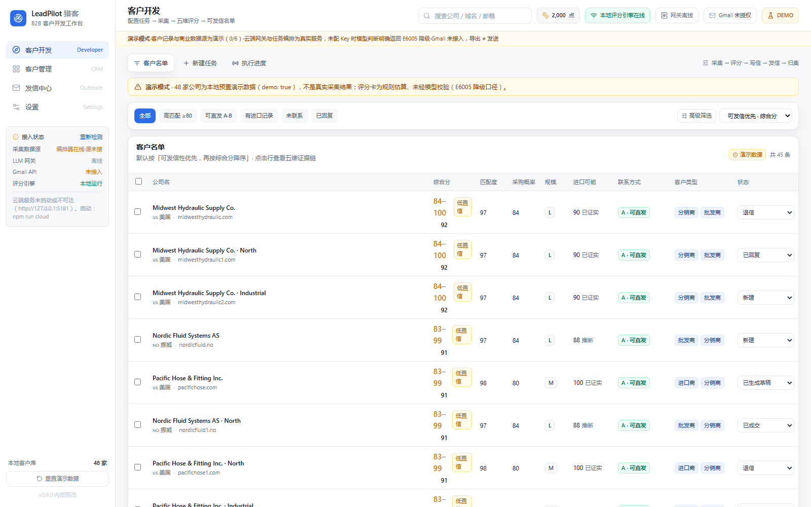
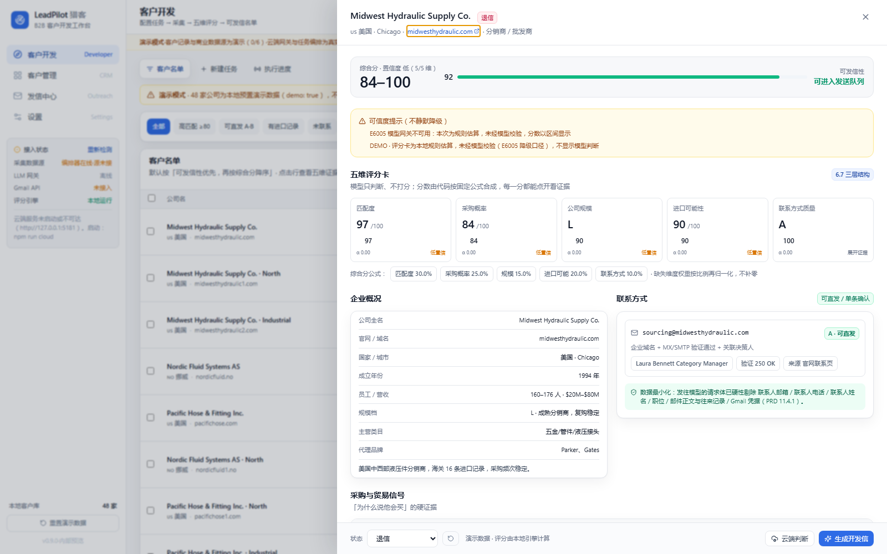
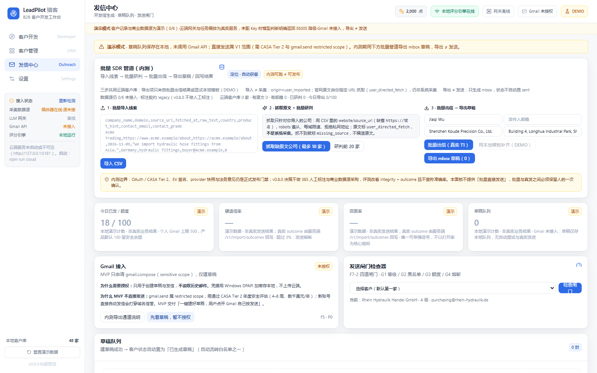
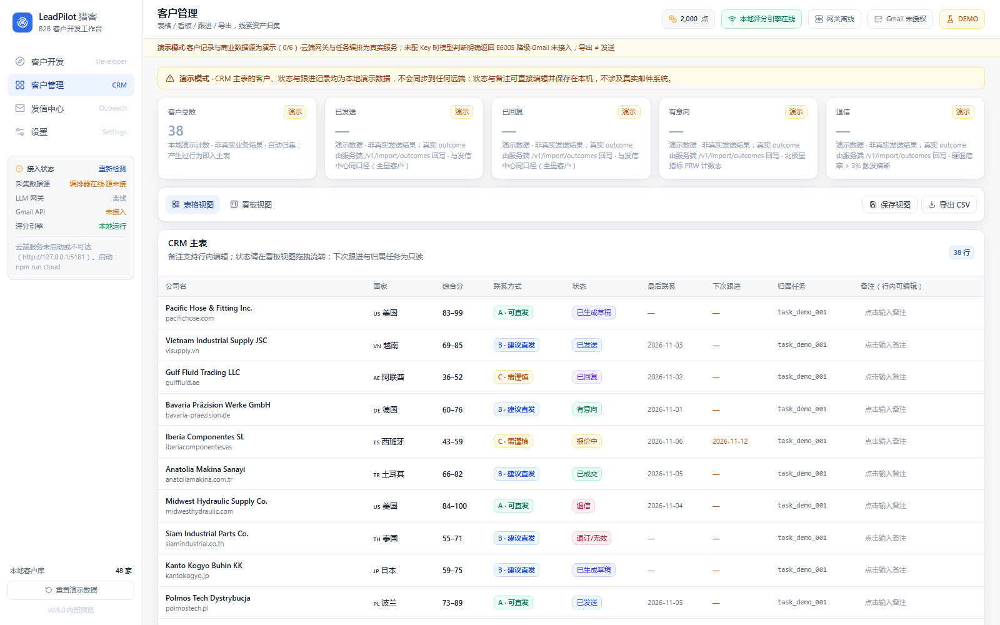
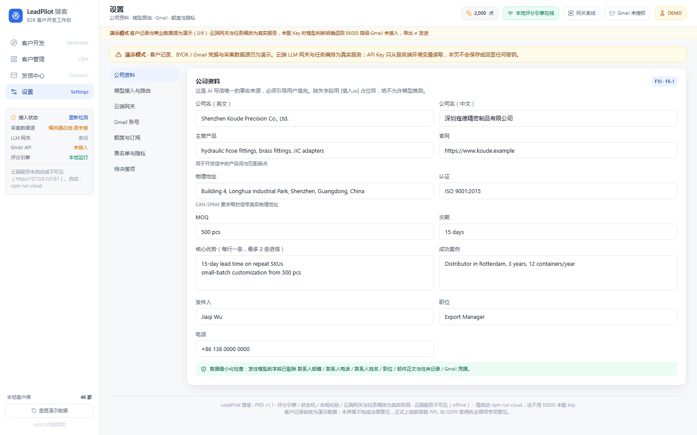

# LeadPilot 猎客

**给外贸业务员手上的客户名单做「体检 + 写信」的工具。**

[](https://github.com/Gakiwoo/LeadPilot/actions/workflows/ci.yml)

当前版本 `v0.9.0` · 内测预览阶段 · 还不能正式对外发布

---

## 这是什么

想象你手上有一张 Excel：展会换来的、海关数据导出的、CRM 里存着的几百家海外公司。
你知道里面有值得开发的客户，但一家家查官网、判断靠不靠谱、写一封像样的开发信，一天也做不了二十家。

LeadPilot 就是干这三件事的：

1. **体检** —— 按五个维度给每家公司打分（采购能力、采购意愿、匹配度、可触达性、风险），并告诉你**分数是从哪句话推出来的**，点一下能看到原文。
2. **写信** —— 给通过筛选的公司生成开发信，缺资料就说缺，不硬凑。
3. **管起来** —— 把草稿导出成邮件客户端能直接导入的格式，发送记录发回来，帮你算退信率，超过 3% 自动踩刹车。

**它不做两件事，而且在界面上也这么写：**

- **不帮你找公司。** 它不爬搜索引擎、不猜网址、不批量采集。名单必须是你自己给的，或者你亲手把官网地址贴进来。
- **不帮你发邮件。** 它只生成草稿，发送永远由你用自己的邮箱点下去。

---

## 能做什么 / 不能做什么

| 能 | 不能 |
|---|---|
| 导入 CSV / JSON 名单，自动去重、逐行告诉你哪行有问题 | 自动发现新公司、爬全网找邮箱 |
| 按你给的网址抓官网原文（遵守 robots 协议，每个站每秒最多 1 次） | 未经你同意去抓任何页面 |
| 给每家公司出五维评分 + 可点开的原文依据 | 凭感觉给一个"AI 打分"却说不出来源 |
| 生成开发信，不合格的要么重写要么明确失败 | 编一段看起来像真的假正文糊弄过去 |
| 导出 mbox 草稿，导入 Foxmail / Thunderbird 直接发 | 直接调用你的邮箱把信发出去 |
| 导入发送结果，算真实退信率，超 3% 熔断 | 用演示数据冒充真实业绩 |
| 演示模式一键看完整流程 | 假装已经接入商业数据源 |

---

## 先看这里：哪些数字不能当真

这一节比功能列表重要。工具里有些地方会显示灰色「—」或者带「演示」标记，那不是坏了，是**故意的**。

| 你看到的 | 真实含义 |
|---|---|
| 列表里 48 家公司、带黄色 DEMO 条 | 演示数据，不是真实客户，第一次打开用来熟悉界面 |
| 某些指标显示「—」而不是数字 | 你还没导入真实发送记录，所以没有真实结果可算。我们不拿 0 或假数字填空 |
| 顶部提示网关离线 / 报 `E6005` | 服务端没配 API Key，所有 AI 功能停用。此时评分只用规则算，并标注"未经模型校验" |
| 报 `E6008` | 配了 Key 但没锁死模型版本号。我们不猜版本号，必须由运维明确指定 |
| 页面写着"数据源 0/6" | 六类商业数据源一个都没接。名单只能靠你导入，或你指定的网址 |
| 分数是个区间而不是单个数字 | AI 不可用时的降级显示，诚实告诉你精度不够 |

**我们不对外宣称准确率。** 因为这个项目没有做过人工标注的对照测试，没有真值就没有准确率可言。
任何在页面或文档里写死准确率数字的文案，都会被自动检查脚本拦下来。

---

## 界面预览

5 张图都是本机真实运行截的，不是设计稿。



<table>
  <tr>
    <td width="50%" valign="top">
      <br>
      <b>客户详情</b> · 五维评分卡、企业概况、采购信号、判断与写信入口
    </td>
    <td width="50%" valign="top">
      <br>
      <b>发信中心</b> · 批量三步流程、发送前检查、草稿队列
    </td>
  </tr>
  <tr>
    <td width="50%" valign="top">
      <br>
      <b>客户管理</b> · 状态看板、跟进日期与备注、CSV 导出
    </td>
    <td width="50%" valign="top">
      <br>
      <b>设置</b> · 公司资料、模型接入、邮箱、合规；左侧如实显示「未接入」
    </td>
  </tr>
</table>

> 想自己重截一遍：先 `npm run dev`，再 `npm run capture:screenshots`。

---

## 三分钟跑起来

需要 **Node 22 或更高版本**。前端后端各一个终端窗口，后端没有任何第三方依赖。

```bash
npm ci

# 窗口 A：后端（端口 5181）
npm run cloud

# 窗口 B：前端（端口 5180）
npm run dev
```

浏览器打开 <http://127.0.0.1:5180/>，就能看到带演示数据的界面。

**不需要配置任何 API Key** —— 不配也能完整走一遍流程，只是 AI 相关的环节会明确提示"降级"，不会假装成功。

想让 AI 真正干活，得配两样东西：一个模型服务的 Key，加一个具体的模型版本号。只配其中一个不会生效，这是刻意的设计。

> 本机开发不配令牌也能用。但如果你要放到服务器上、经 Nginx 之类反代出去，**必须**设 `LEADPILOT_API_TOKEN`，否则服务会直接拒绝启动 —— 防止有人把内部工具裸奔在公网。

---

## 一次完整的使用流程

```
① 导入名单（CSV/JSON）
        ↓  每行标「用户导入」，谎称是系统采集会被拒绝
② 补原文（可选，你贴官网地址，或批量抓你名单里的官网）
        ↓  只抓你给的网址，遵守 robots，抓不到就记「缺原文」
③ 批量研判
        ↓  先用规则从原文抄事实（带原句可点开），再让 AI 做判断
        ↓  未配 Key / 模型不可用 → 明确标"降级"，不写进成功
④ 批量出信
        ↓  降级时正文留空，绝不编造；你可以选择用本地模板补一份，但会标 DEMO
⑤ 导出草稿（mbox）
        ↓  只是草稿文件，状态停在「已起草」
⑥ 你自己用邮箱发送
        ↓
⑦ 把发送结果导回来
        ↓  退信率超过 3% → 自动熔断，停止后续导出
```

每一步的失败都会**逐条**告诉你是哪一行、为什么失败，不会整批静默吞掉。

---

## 名词对照

| 你会看到的词 | 大白话 |
|---|---|
| T0 | 不用 AI，用固定规则从官网原文里抄事实，每条都附原句 |
| T1 | AI 写开发信 |
| T2 | 拿不准或有冲突的客户，交给 AI 复核 |
| 降级 / degrade | 该用 AI 的地方用不了，改为规则结果，并明确标出来 |
| 熔断 | 退信太多，自动暂停后续发送，防止越错越多 |
| mbox | 一种邮件客户端通用格式，导入后就是一封封草稿 |
| DEMO / 演示 | 假数据，仅供你看界面用 |
| 五维评分 | 采购能力 / 采购意愿 / 匹配度 / 可触达性 / 风险，五个方面各打一分 |

---

## 给开发者

### 常用命令

```bash
npm run dev            # 前端开发服务器
npm run cloud          # 后端（网关 + 任务编排）
npm test               # 单元测试：293 个用例，17 个文件
npm run lint           # 代码检查
npm run typecheck      # 类型检查
npm run gate           # 发布门禁自检（79 项）
npm run build          # 生产构建
npm run smoke          # 端到端冒烟（需先启动后端）
npm run verify:restart # 杀进程后断点续跑验证
```

### 目录怎么分的

```
src/      前端（React + TypeScript）
  app/          入口、路由、全局错误兜底
  components/   页面与组件（layout / ui / 各业务页）
  domain/       纯计算逻辑，不碰界面也不联网
  services/     所有对外请求的唯一出口
  store/        全局状态
  data/ types/  演示数据、存储适配、数据模型

server/   后端（Node 原生 http，零依赖）
  index.mjs     启动入口
  app.mjs       组装与请求流程
  routes/       各个接口
  core/         业务规则（协议、账本、评测、抽取）
  services/     网关、编排、批次、抓取
  persistence/  存储（sqlite / json / 内存）

tests/          全部测试（frontend / server）
shared/         前后端共用的协议定义（改这里两边一起变）
config/         构建与检查配置（Vite / Tailwind / PostCSS / ESLint）
scripts/        校验与发布门禁脚本
```

根目录只保留必须放在根的文件：`package.json`、`package-lock.json`、`tsconfig.json`、`index.html`、`README.md` 与几个工具自动发现用的点文件。

### 接口

`/health` 不需要令牌，其余 `/v1/*` 在对外监听或配置令牌后都需要。

<details>
<summary>展开端点清单</summary>

| 方法 | 路径 | 干什么 |
|---|---|---|
| GET | `/health` | 体检：版本、网关、安全、存储、账本、数据源状态 |
| GET | `/v1/points` | 看点数余额和流水（只读） |
| POST | `/v1/t0/extract` | 从原文抽事实（规则，不调 AI） |
| POST | `/v1/judge` | 给一家公司做判断 |
| POST | `/v1/email/generate` | 给一家公司写信 |
| GET / POST | `/v1/tasks` | 云端任务列表 / 新建 |
| GET | `/v1/tasks/:id/events` | 任务进度实时推送（SSE） |
| POST | `/v1/tasks/:id/pause` `resume` `abort` | 暂停 / 继续 / 中止 |
| POST | `/v1/import/companies` | 导入名单 |
| POST | `/v1/batch/judge` | 批量研判 |
| POST | `/v1/batch/generate-drafts` | 批量出信 |
| POST | `/v1/export/eml` | 导出 mbox 草稿 |
| POST | `/v1/import/outcomes` | 回写发送结果 |
| GET / POST | `/v1/suppressions` · `/v1/import/suppressions` | 黑名单与退订（只增不删） |
| POST | `/v1/sources/fetch` | 抓你指定的网址 |
| POST | `/v1/batch/fetch-sources` | 批量为名单补官网原文 |
| POST | `/v1/eval/integrity` `/v1/eval/outcome` `/v1/eval/diff` | 质量自评与版本对比 |
| GET | `/v1/release/status` | 当前离"可发布"还差什么 |

</details>

### 改代码前值得知道的三条

1. **界面不直接调服务。** 组件只能从 `services/adapters.ts` 取能力，绕过去会被门禁脚本拦下。
2. **模型不负责打分。** AI 只能输出"是/否/不确定"这类判断，分数一律由 `domain/scoring.ts` 算。这样分数永远可解释。
3. **没数据就显示没数据。** 宁可显示「—」也不要补 0。这是整个项目的底线，改动前请先想清楚会不会破坏它。

更多技术决策见 [`docs/ARCHITECTURE.md`](docs/ARCHITECTURE.md)（34 条 ADR），配置项见 [`.env.example`](.env.example)。

---

## 当前进度

| 项目 | 状态 |
|---|---|
| 五维评分引擎 | ✅ 可用 |
| 十二态状态机 + 合规红线 | ✅ 可用 |
| 云端 AI 网关（三级路由、熔断、缓存、审计） | ✅ 可用 |
| 任务编排（进度推送、暂停继续、断点续跑） | ✅ 可用 |
| 点数账本（预扣 / 结算 / 退款，幂等） | ✅ 可用 |
| 批量导入 → 研判 → 出信 → 导出 → 回写 | ✅ 内测可用 |
| 用户指定网址抓取 | ✅ 可用 |
| 真实 AI 调用 | 🟡 配好 Key 和版本号即可用 |
| 六类商业数据源 | ⚪ 一个都没接（如实显示 0/6） |
| 人工标注对照测试 | ❌ 决定不做，所以不宣称准确率 |
| Gmail 授权 / 桌面客户端 / 代码签名 | ❌ 未开始，都是正式发布前必须解决的 |
| 打包后的依赖漏洞 | ✅ 0（CI 每次实跑）；开发工具链有 6 条已知漏洞，只影响开发机，见 [`docs/DEPENDENCY-DECISION.md`](docs/DEPENDENCY-DECISION.md) |

`npm run gate` 每次都会输出 5 条「还卡在哪」，比如"没有 100 条真实原文样本""没有 30 条真实发送记录""外部合规 0/4"。这些不是失败，是**清单**。

---

## 文档

| 文档 | 里面有什么 |
|---|---|
| [`docs/ARCHITECTURE.md`](docs/ARCHITECTURE.md) | 技术决策记录（ADR-001–034） |
| [`docs/PM-REVIEW.md`](docs/PM-REVIEW.md) | 产品评审、范围取舍、为什么砍掉某些功能 |
| [`docs/PRD-COVERAGE.md`](docs/PRD-COVERAGE.md) | 需求逐条对照：做了 / 没做 / 为什么 |
| [`docs/RELEASE-CHECKLIST.md`](docs/RELEASE-CHECKLIST.md) | 发布前还缺哪些证据和外部审批 |
| [`shared/model-protocol.json`](shared/model-protocol.json) | 前后端共用的协议定义（改这里两边一起变） |

---

本仓库不构成法律意见。正式上线前，PIPL 与 GDPR 相关事项需取得执业律师的专项意见。
